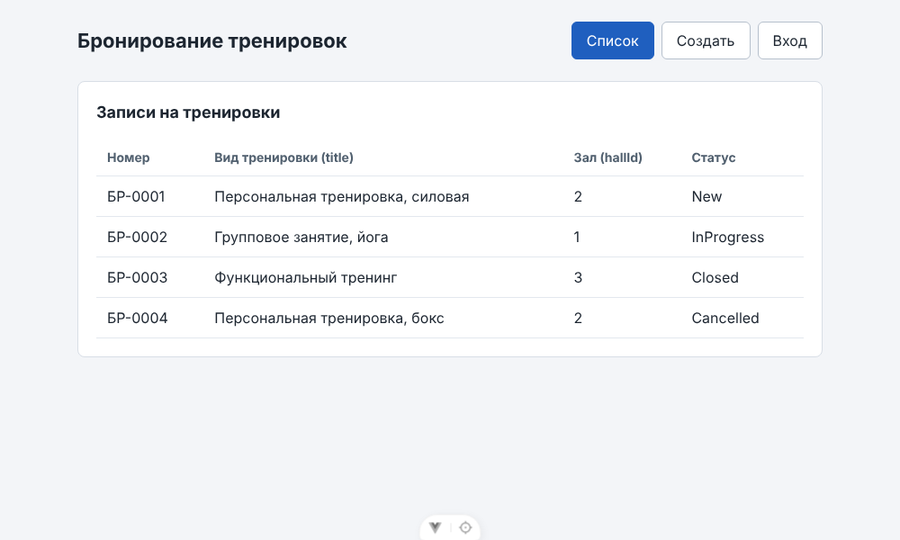
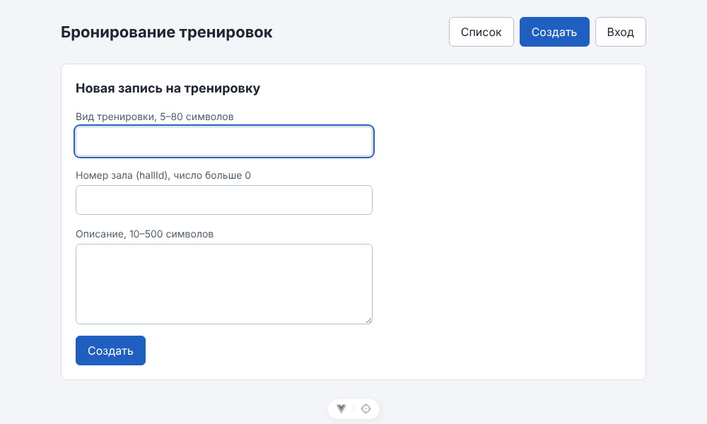
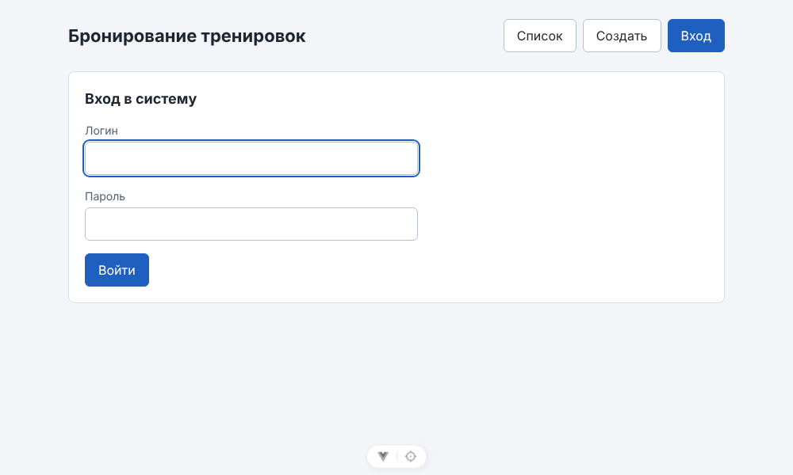

# ЛР3. Vue: каркас и три экрана

Клиент лежит в папке `frontend/`: Vue 3 + Vite, язык JavaScript. Сервер и база пока не нужны.

## Запуск

```bash
cd frontend
npm install
npm run dev
```

Открыть адрес Vite, обычно `http://localhost:5173`.

## Экраны

Переключаются тремя кнопками в шапке, одновременно показан один экран (`v-if` / `v-else-if` / `v-else` по переменной `screen`).

### Список

Таблица: номер, вид тренировки (`title`), зал (`hallId`), статус. Четыре тестовые строки выводятся через `v-for`.



### Создание

Форма: `title`, `hallId`, `description`, кнопка «Создать».



### Вход

Форма: `login`, `password`, кнопка «Войти».



## Соответствие полей ЛР2

| Поле курса | Поле моей темы | Где описано |
|------------|----------------|-------------|
| `title` | `title` (вид тренировки, 5–80) | docs/api-contract.md, POST /api/bookings |
| `siteId` | `hallId` (зал, число больше 0) | docs/data-model.md, словарь: Site → Hall |
| `description` | `description` (10–500) | docs/api-contract.md, POST /api/bookings |
| логин, пароль | `login`, `password` | docs/api-contract.md, POST /api/auth/login |

Статусы в списке — только `New`, `InProgress`, `Closed`, `Cancelled`.

Критерий 1 ЛР1 («Создать запись») закрывают поля `title`, `hallId`, `description` на экране создания.

## Чеклист семантики и доступности

| № | Проверка | да/нет |
|---|----------|--------|
| 1 | Рабочая область обёрнута в `<main>` | да |
| 2 | Создание и вход используют `<form>` | да |
| 3 | У каждого поля есть связанный `<label>` (`for` / `id`) | да |
| 4 | Список — `<table>` | да |
| 5 | Первое поле создания получает фокус | да |
| 6 | У `v-for` есть `:key="item.id"` | да |
| 7 | Стили в `scoped`, читаемы и не скрывают подписи | да |
