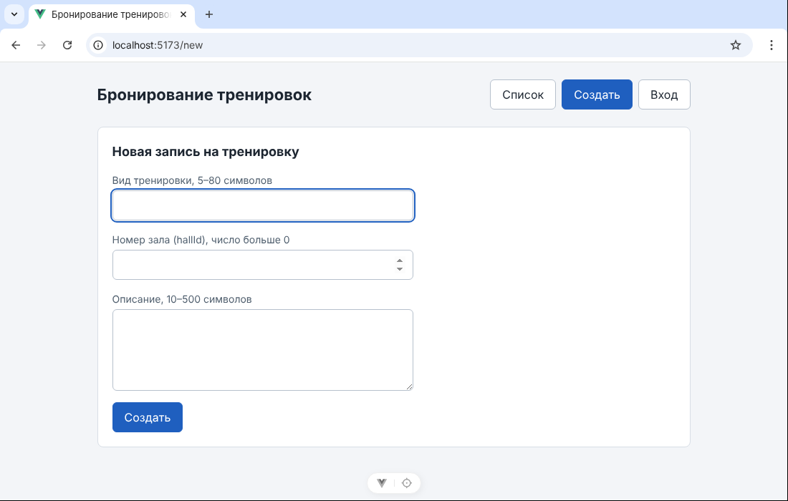

# ЛР4. Vue: компоненты и маршруты

Каркас из ЛР3 разрезан на компоненты и страницы, подключён `vue-router`. Pinia не используется.

## Запуск

```bash
cd frontend
npm install
npm run dev
```

Открыть адрес Vite, обычно `http://localhost:5173`.

## Три адреса

| Адрес | Страница | Что показывает |
|-------|----------|----------------|
| `/` | `pages/BookingList.vue` | список записей на тренировки |
| `/new` | `pages/BookingNew.vue` | форма создания: `title`, `hallId`, `description` |
| `/login` | `pages/Login.vue` | вход: `login`, `password` |

Каждый адрес открывается вручную из адресной строки и после перезагрузки страницы (F5). Меню сделано ссылками `router-link`, кнопок с `v-if` больше нет.

Адрес `/new` — это маршрут Vue: он только показывает форму. Запись создаст будущий запрос к серверу `POST /api/bookings` (docs/api-contract.md).

### Скриншот `/new` с адресной строкой



Остальные экраны: [список `/`](../screenshots/lab-04/01-list.png), [вход `/login`](../screenshots/lab-04/03-login.png).

## Дерево `frontend/src`

```text
src/
├── main.js                  ← подключает роутер: app.use(router)
├── App.vue                  ← AppHeader и router-view
├── router.js                ← три маршрута
├── bookingsStore.js         ← единственный общий массив записей
├── assets/
│   └── main.css
├── components/
│   ├── AppHeader.vue        ← шапка с меню из router-link
│   └── BookingTable.vue     ← таблица, получает items через props
└── pages/
    ├── BookingList.vue
    ├── BookingNew.vue
    └── Login.vue
```

## Соответствие имён курса и моей темы

По словарю из docs/data-model.md: Ticket → Booking (запись на тренировку), Site → Hall (зал).

| Имя в методичке | Имя в проекте |
|-----------------|---------------|
| `ticketsStore.js` | `bookingsStore.js` |
| `TicketTable.vue` | `BookingTable.vue` |
| `TicketList.vue` | `BookingList.vue` |
| `TicketNew.vue` | `BookingNew.vue` |
| `Login.vue` | `Login.vue` |
| `siteId` | `hallId` |
| `POST /api/tickets` | `POST /api/bookings` |

## Схема: шапка снаружи, `router-view` внутри

```text
App.vue
├── AppHeader                      ← одна на всё приложение, не копируется в страницы
│     router-link: /  /new  /login
└── <main>
      └── router-view              ← сюда роутер подставляет страницу по адресу
            ├── /       → BookingList → BookingTable (:items="bookings")
            ├── /new    → BookingNew
            └── /login  → Login
```

Шапка стоит в `App.vue` снаружи `router-view`, поэтому при переходе между адресами она остаётся на месте, меняется только страница внутри.

## Кто владеет данными

Массив записей лежит только в `bookingsStore.js`. Страница `BookingList.vue` импортирует его и передаёт таблице: `<BookingTable :items="bookings" />`. Таблица `BookingTable.vue` получает массив через обязательный prop `items` из `bookingsStore.js` и не хранит копию и не создаёт свой тестовый массив.

## Чеклист

### Маршруты

- [x] `vue-router` установлен (есть в `package.json` и `package-lock.json`)
- [x] `/`, `/new`, `/login` открываются вручную
- [x] меню на `router-link`
- [x] старые кнопки с `v-if` удалены

### Компоненты и данные

- [x] есть `AppHeader.vue`, `BookingTable.vue` и три страницы
- [x] шапка не пропадает при навигации
- [x] таблица объявляет обязательный prop `items` и не хранит копию
- [x] единственный массив — в `bookingsStore.js`
- [x] Pinia не используется

### Git

- [x] `package.json` и lock-файл в коммите
- [x] `node_modules` не в Git
