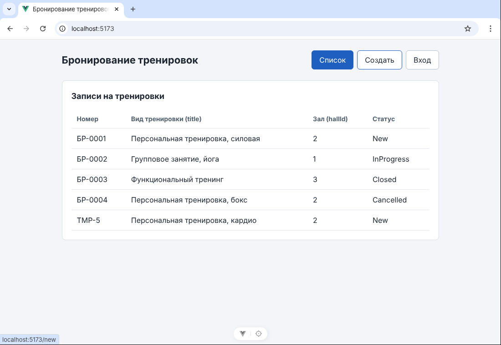
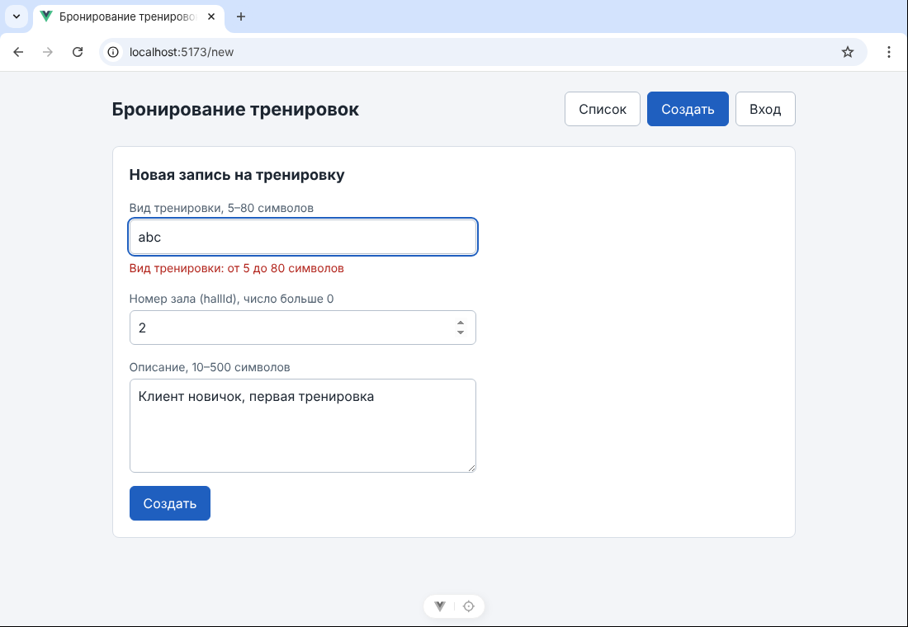
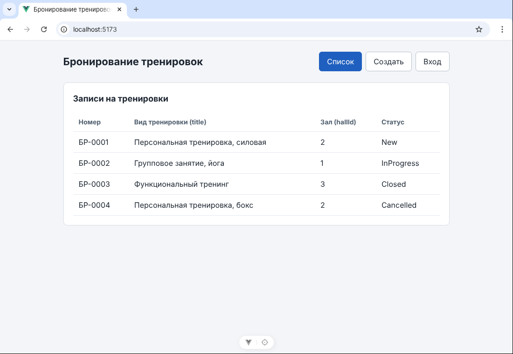

# ЛР5. Vue: форма и список в памяти

Форма на `/new` связана с общим массивом из `bookingsStore.js`. Успешная отправка добавляет запись со статусом `New` и переводит на список. Сервера и базы пока нет: данные живут в памяти вкладки.

## Запуск

```bash
cd frontend
npm install
npm run dev
```

Открыть адрес Vite, обычно `http://localhost:5173`.

## Что изменилось

| Файл | Что сделано |
|------|-------------|
| `frontend/src/bookingsStore.js` | массив `bookings`, счётчик `nextId`, функция `addBooking` |
| `frontend/src/pages/BookingNew.vue` | `v-model` на трёх полях, проверки, `@submit.prevent="onCreate"` |

Имена по словарю ЛР2 (Ticket → Booking, Site → Hall): в методичке это `ticketsStore.js`, `items`, `addItem`, `TicketNew.vue`, `siteId`.

## Правила проверки

| Поле | Правило | Текст ошибки под полем |
|------|---------|------------------------|
| `title` | 5–80 символов после `trim` | Вид тренировки: от 5 до 80 символов |
| `hallId` | целое число больше 0 | Зал: целое число больше 0 |
| `description` | 10–500 символов после `trim` | Описание: от 10 до 500 символов |

Если есть хотя бы одна ошибка, функция `onCreate` выходит через `return` до вызова `addBooking`, запись не добавляется. Строка из одних пробелов тоже отклоняется.

Проверка в форме нужна для удобства пользователя. Сервер позже повторит те же правила (docs/api-contract.md, ответ 400).

## Новая запись

| Поле | Откуда значение |
|------|-----------------|
| `id` | учебный счётчик `nextId` (5, 6, 7…), в текущей сессии не повторяется |
| `number` | `TMP-` и значение счётчика; настоящий номер выдаст сервер в ЛР6 |
| `title`, `description` | из формы, пробелы по краям обрезаны |
| `hallId` | из формы, хранится числом (`v-model.number`) |
| `status` | всегда `New`, из формы не берётся |

## Три проверки

| Проверка | Что делаю | Факт |
|----------|-----------|------|
| Успех | На `/new` ввожу вид тренировки «Персональная тренировка, кардио», зал `2`, описание «Клиент новичок, первая тренировка», нажимаю Enter | Переход на `/`, в таблице появилась строка `TMP-5` со статусом `New`. Страница не перезагружалась |
| Отказ | На `/new` ввожу вид тренировки `abc`, остальные поля правильные, нажимаю Enter | Под полем ошибка «Вид тренировки: от 5 до 80 символов», остаюсь на `/new`, в списке по-прежнему 4 строки |
| Память | После успешного создания нажимаю F5 на списке | Добавленная строка исчезла, осталось 4 тестовые записи. Это ожидаемо: сервера и базы данных пока нет, массив хранится только в памяти вкладки |

### Успех



### Отказ



### После F5



## Где что пишется

| В `<script setup>` | В `<template>` |
|--------------------|----------------|
| `const form = ref({...})` | `v-model="form.title"` (без `.value`) |
| `form.value.title.trim()` (через `.value`) | `v-model.number="form.hallId"` |
| функция `onCreate`, вызов `addBooking(...)` | `@submit.prevent="onCreate"` |
| `router.push('/')` | `{{ errors.title }}`, `v-if="errors.title"` |

## Чеклист

### Форма

- [x] три поля связаны через `v-model`
- [x] у `hallId` есть `.number`
- [x] используется `@submit.prevent`
- [x] Enter не перезагружает страницу
- [x] у каждого поля есть `label`
- [x] после успеха форма очищается

### Правила и данные

- [x] вид тренировки после `trim` — 5–80 символов
- [x] значение короче 5 символов не добавляется
- [x] `hallId` — целое число больше нуля
- [x] описание — 10–500 символов
- [x] ошибка показана рядом с полем
- [x] новая запись имеет `status: 'New'`
- [x] `id` не повторяется в текущей сессии
- [x] используется один массив из `bookingsStore.js`

### Проверка результата

- [x] после успеха переход на `/`
- [x] новая строка видна без ручной правки кода
- [x] двойное нажатие Enter проверено: добавляется одна запись
- [x] после F5 добавленная запись исчезает
- [x] в отчёте есть успех, отказ и F5
