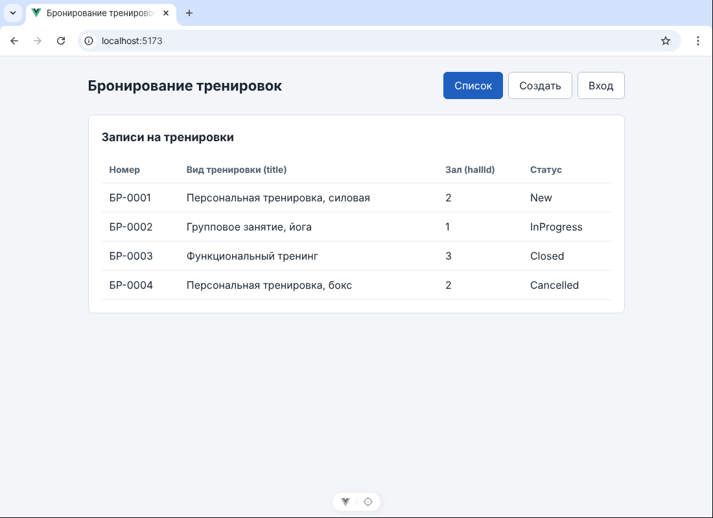
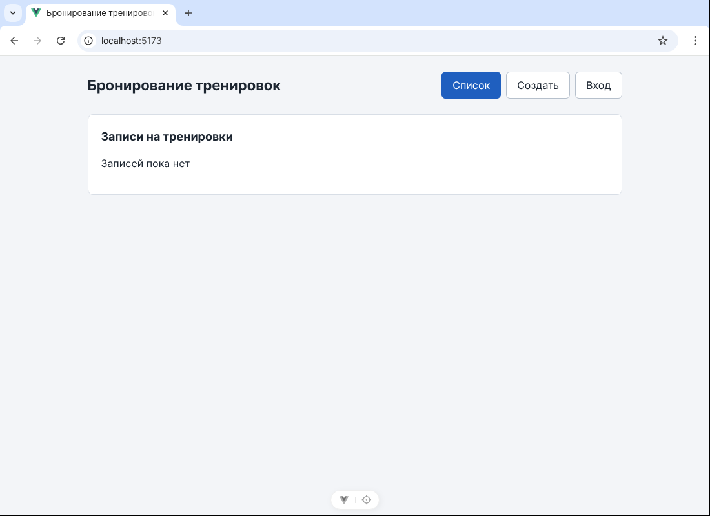
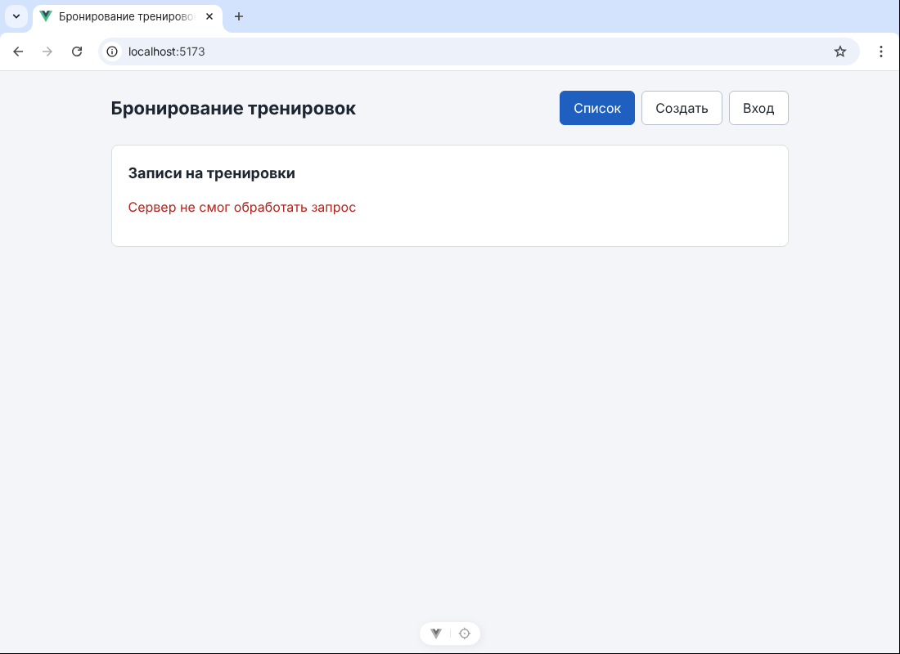
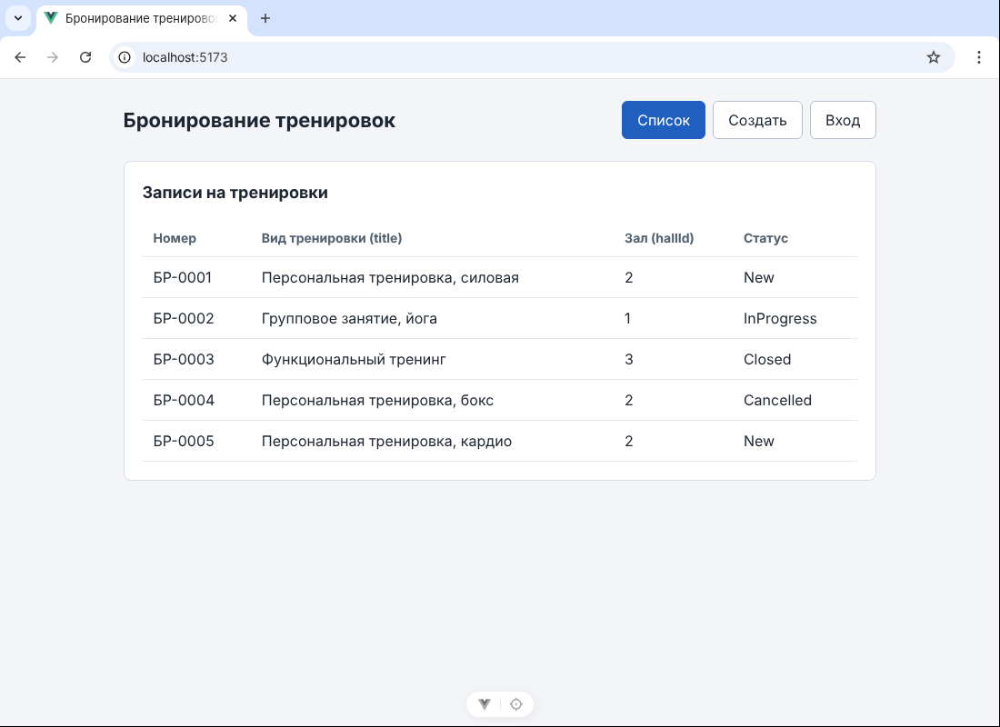
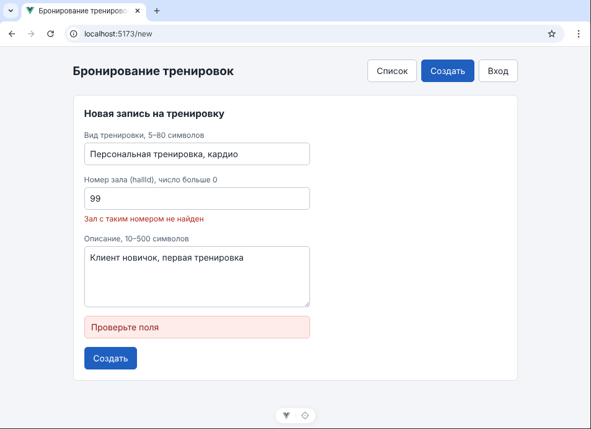
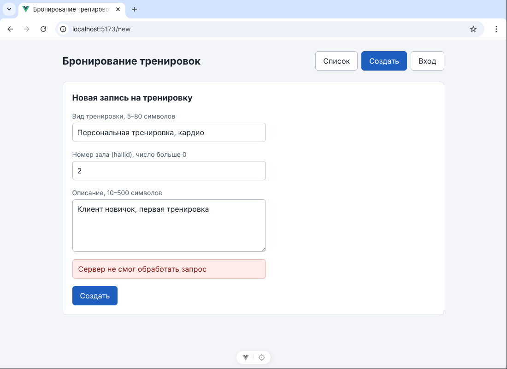
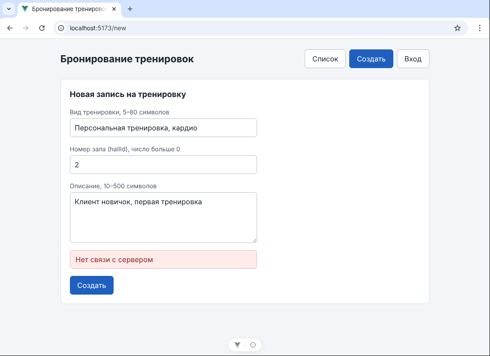
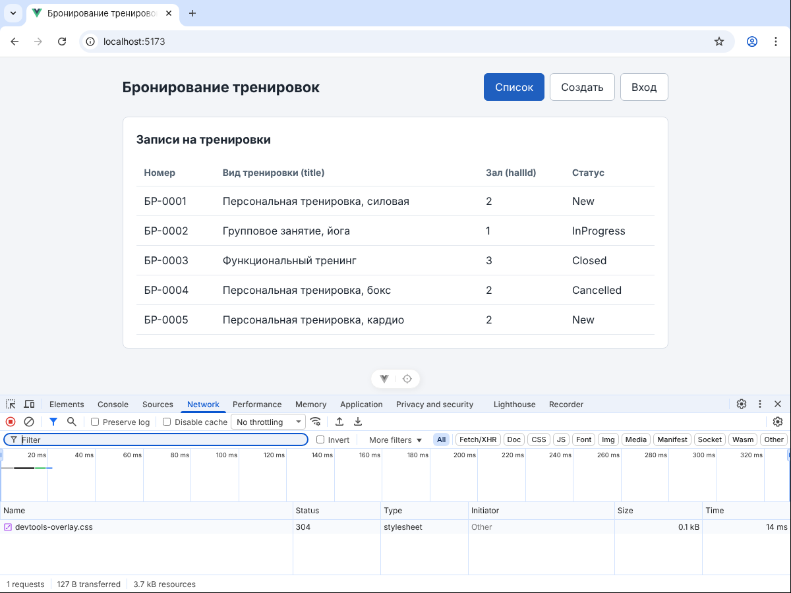
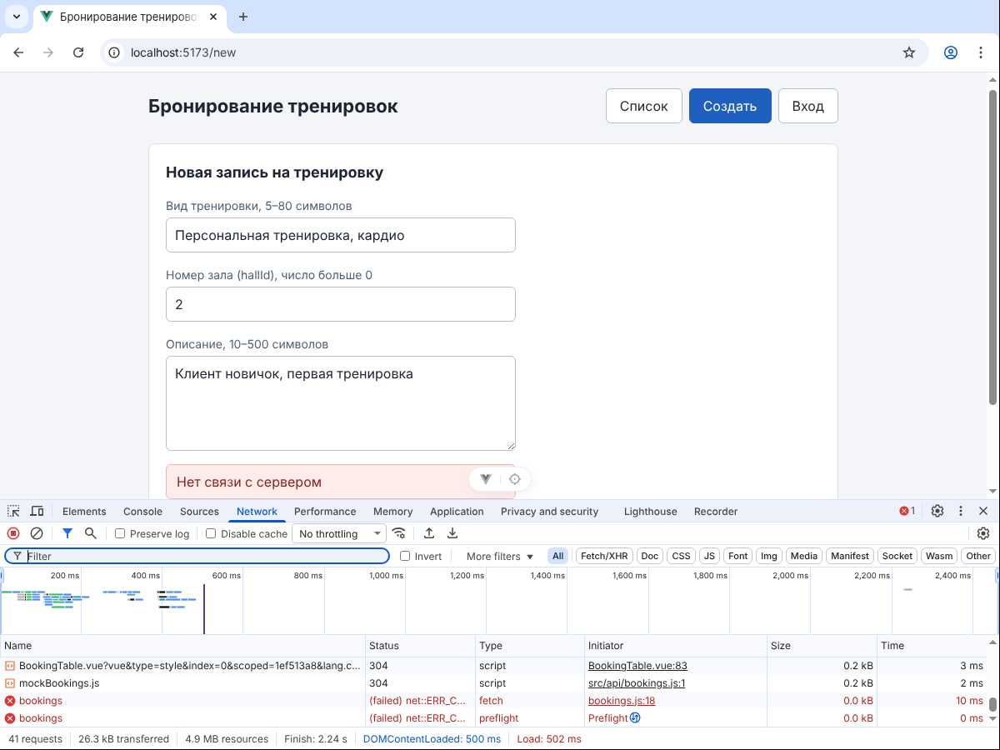

# ЛР6. Vue: клиент API и mock

Список и форма больше не трогают массив напрямую: они вызывают функции API-модуля. Пока сервера нет, за него отвечает mock. Список показывает одно из четырёх состояний, кнопка «Создать» блокируется на время запроса.

## Запуск

```bash
cd frontend
copy .env.example .env
npm install
npm run dev
```

Открыть адрес Vite, обычно `http://localhost:5173`. После правки `.env` перезапустить `npm run dev`.

## Файлы

| Файл | Что в нём |
|------|-----------|
| `frontend/.env.example` | `VITE_API_BASE_URL=http://localhost:5000`, лежит в Git |
| `frontend/.env` | локальная копия, в Git не попадает (`.gitignore`) |
| `frontend/src/api/bookings.js` | `getBookings`, `createBooking`, переключатель `USE_MOCK`, запрос через `fetch`, тексты отказов |
| `frontend/src/api/mockBookings.js` | учебный «сервер»: задержка 0,5 с, ответы 200, 201, 400, 500 |
| `frontend/src/bookingsStore.js` | общий массив `bookings`, заполняется ответом `getBookings()` |
| `frontend/src/pages/BookingList.vue` | загрузка в `onMounted`, поле `screen`: `loading`, `empty`, `data`, `error` |
| `frontend/src/pages/BookingNew.vue` | проверка полей, `createBooking`, блокировка кнопки, сообщения |

Имена по словарю ЛР2 (Ticket → Booking, Site → Hall): в методичке это `tickets.js`, `mockTickets.js`, `getTickets`, `createTicket`, `/api/tickets`, `siteId`.

Адрес сервера записан только в `.env` и читается только в `src/api/bookings.js` через `import.meta.env.VITE_API_BASE_URL`. Страницы не знают адреса и не импортируют mock, они вызывают `getBookings()` и `createBooking(body)`. axios не используется.

## Состояния списка

Одно поле `screen`, ветки `v-if` / `v-else-if` / `v-else` взаимоисключающие.

| Состояние | Что видит человек | Когда |
|-----------|-------------------|-------|
| `loading` | «Загрузка…» | запрос не завершён |
| `empty` | «Записей пока нет» | ответ 200, массив пуст |
| `data` | таблица | ответ 200, массив не пуст |
| `error` | текст отказа | ответ 500 или нет связи |

Загрузка:



Пусто (в `mockBookings.js` временно `emptyList: true`):



Ошибка (в `mockBookings.js` временно `force500: true`):



## Создание записи

1. Форма проверяет поля (правила из ЛР5). При ошибке запрос не отправляется.
2. Вызывается `createBooking({ title, hallId, description })`.
3. `id`, `number` и `status: 'New'` приходят в ответе 201. Форма их не вычисляет.
4. После успеха переход на `/`, список загружается заново вместе с новой записью.
5. При отказе поля остаются заполненными, кнопка снова активна (флаг снимается в `finally`).

Пока идёт запрос, на кнопке текст «Создаём…», она отключена (`:disabled="isSubmitting"`). Двойной Enter проверен: создаётся одна запись.

Успех — строка `БР-0005` со статусом `New`, номер выдал mock:



## Чеклист трёх отказов

| Отказ | Как получил | Ветка в коде | Текст человеку | Проверено |
|-------|-------------|--------------|----------------|-----------|
| 400 | в поле зала номер `99`, которого нет в справочнике mock | `!response.ok`, статус 400 | «Проверьте поля», под полем «Зал с таким номером не найден» | да |
| 500 | в `mockBookings.js` поставил `force500: true` | `!response.ok`, статус 500 | «Сервер не смог обработать запрос» | да |
| Нет связи | в `bookings.js` поставил `USE_MOCK = false`, сервер на порту 5000 не запущен | `catch`, у ошибки нет статуса | «Нет связи с сервером» | да |

Mock отвечает 400 и на вид тренировки короче 5 символов, как сервер из docs/api-contract.md. Но такую строку форма останавливает сама ещё до запроса и тоже показывает «Проверьте поля». Поэтому ответ 400 воспроизведён через номер зала: форма проверяет только «число больше 0», а есть ли такой зал, знает только сервер.

Ответы 400 и 500 — это ответы сервера, в `catch` они сами не попадают: функция `unwrap` в `bookings.js` проверяет `ok` и выбрасывает ошибку со статусом. Отсутствие связи — другой случай: ответа нет вообще, `fetch` выбрасывает ошибку сам, статуса у неё нет. Кодом 500 она не подменяется.

Отказ 400:



Отказ 500:



Нет связи:



## Network

Успешное создание на mock. HTTP-запроса к порту 5000 нет — **mock без HTTP**, это ожидаемо: функция `createBooking` вызывает `mockCreateBooking` напрямую. Запрос `POST http://localhost:5000/api/bookings` появится здесь, когда в `bookings.js` будет `USE_MOCK = false` и заработает сервер.



Нет связи (`USE_MOCK = false`, сервер не запущен). В Network видна неуспешная попытка `POST http://localhost:5000/api/bookings`: статус `(failed) net::ERR_CONNECTION_REFUSED`.



## Чеклист

### Файлы и API

- [x] есть `frontend/.env.example`
- [x] адрес API — `http://localhost:5000`
- [x] `.env` не отслеживается Git
- [x] есть `src/api/bookings.js` и `src/api/mockBookings.js`
- [x] экспортируются `getBookings` и `createBooking`
- [x] реальная ветка использует встроенный `fetch`
- [x] axios не используется

### UI

- [x] список показывает загрузку
- [x] пустой список отличается от загрузки
- [x] данные показаны таблицей
- [x] ошибка показана отдельно
- [x] во время создания кнопка disabled
- [x] двойной клик создаёт одну запись
- [x] `id` и `number` взяты из ответа
- [x] после отказа поля можно исправить

### Отказы и Network

- [x] воспроизведены 400, 500 и отсутствие связи
- [x] для трёх случаев разные тексты
- [x] проверена ветка `!response.ok`
- [x] проверена ветка `catch`
- [x] есть скриншот Network успеха (mock без HTTP)
- [x] есть скриншот Network отказа (нет связи)
